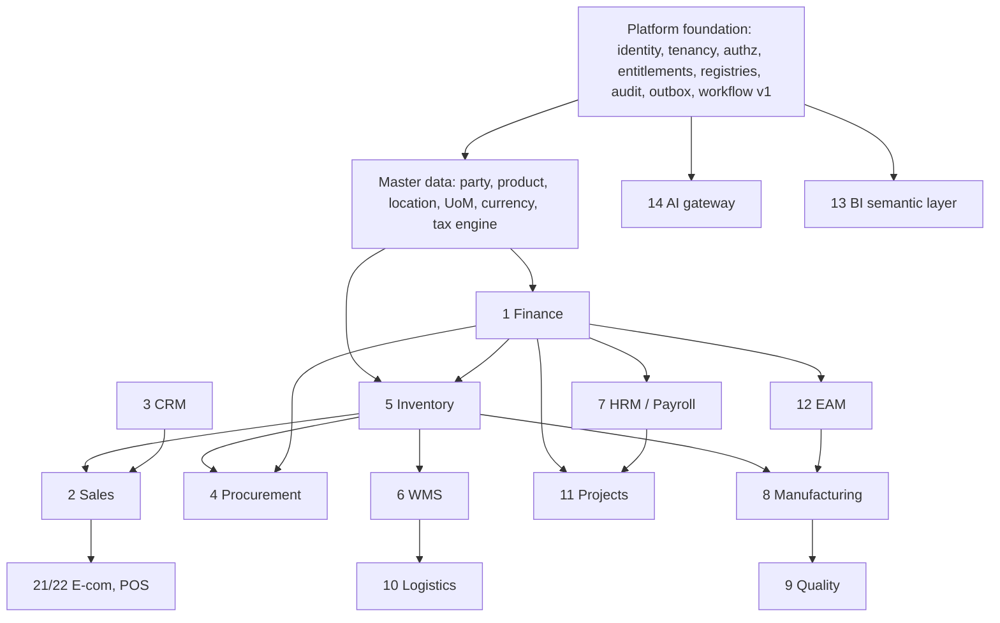

# UEOS — Unified Application Registry (reconciled)

Status: Proposed. Detail level: **Full** = numbered feature-level DRD supplied · **Module** = module/submodule/entity list only · **Stub** = one paragraph · **Missing** = not supplied.
Relationship: **Primary** = canonical implementation · **Merge→N** = duplicate of Part N, becomes a SKU · **Overlap** = own app sharing an engine · **Platform** = shared service sold as an app.
Wave: **P** platform · **A** core business (master PRD Phase 6) · **B** advanced (Phase 7) · **C** commerce/people extras · **D** vertical (demand-driven).

| # | Domain | Detail | Relationship | Owns (master data) | Key dependencies | Wave |
|---|---|---|---|---|---|---|
| 1 | Finance & Accounting | Full (630) | Primary | GL, AR/AP ledgers, fiscal calendar, fixed-asset books, budgets | master.party, tax engine, currency | A |
| 2 | Sales Management | Full (895) | Primary | Quotes, orders, price lists, commissions | CRM, Inventory, Finance | A |
| 3 | CRM | **Missing** (1526–2323 reserved) | Primary | Leads, opportunities, activities | master.party | A |
| 4 | Procurement | Full (1,013) | Primary | Requisitions, RFQ, tenders, POs | Supplier mgmt, Finance budget, Inventory | A |
| 5 | Inventory | Full (1,132) | Primary | Stock ledger, reservations, batches/serials | PIM/product registry, Finance | A |
| 6 | Warehouse (WMS) | Full (477) | Primary | Bins/zones, tasks, waves | Inventory, master.location | A |
| 7 | HRM (+recruit, payroll, attendance) | Full (500) | Primary | Employee, positions, payroll runs | Identity, Finance | A |
| 8 | Manufacturing | Full (519) | Primary | BOM, routing, production orders | Inventory, PLM, QMS | B |
| 9 | Quality Management | Module | Primary | Inspections, NCR, CAPA | Inventory, Mfg, Procurement | B |
| 10 | Logistics / TMS | Module | Primary | Shipments, fleet, carriers | WMS, Sales, Finance | B |
| 11 | Project Management | Module | Primary | Projects, tasks, timesheets | HRM, Finance | A |
| 12 | Asset & Maintenance (EAM) | Module | Primary | Physical assets, work orders | Finance, Inventory, HRM | A |
| 13 | BI & Decision Intelligence | Stub | Platform | Semantic layer, dashboards | all apps | P/B |
| 14 | AI/ML Platform | Stub | Platform | Models, agents, KBs | authz, DMS | P |
| 15 | Data Mgmt & Governance | Stub | Platform | Catalog, lineage, quality rules | — | P/B |
| 16 | BPA / RPA | Stub | Platform | Workflow definitions/runs | — | P |
| 17 | CRM | Stub | **Merge→3** | — | — | A |
| 18 | Sales | Stub | **Merge→2** | — | — | A |
| 19 | Marketing | Stub | Primary | Campaigns, audiences | CRM | C |
| 20 | Customer Service & Support | Stub | Primary | Tickets, SLAs, KB | CRM | C |
| 21 | E-commerce | Stub | Primary | Storefronts, carts | Sales, Inventory, Payments | C |
| 22 | Point of Sale | Stub | Primary | Terminals, sessions | Sales, Inventory, Payments | C |
| 23 | Subscription & Recurring Revenue | Stub | Overlap (Sales 15/16, billing lib) | Plans, subs (tenant-scoped) | Finance | C |
| 24 | Loyalty & Rewards | Stub | Overlap (Sales promos) | Programs, points | CRM | C |
| 25 | HRM | Stub | **Merge→7** | — | — | A |
| 26 | Recruitment / ATS | Stub | **Merge→7** | — | — | A |
| 27 | Payroll | Stub | **Merge→7** | — | tax engine | A |
| 28 | Workforce & Attendance | Stub | **Merge→7** | — | — | A |
| 29 | LMS | Stub | Overlap (HR learning) | Courses, enrolments | HRM | C |
| 30 | Performance & Talent | Stub | Overlap (HR 19–23) | Cycles, goals | HRM | C |
| 31 | Treasury | Stub | Overlap (Finance bank/cash) | Cash positions, forecasts | Finance | B |
| 32 | Tax Management | Stub | Overlap (Finance tax) → **tax engine** | Jurisdictions, rules, returns | Finance | A |
| 33 | GRC | Stub | Overlap (audit/risk in 1, 4, 9) | Risk register, controls | — | B |
| 34 | Legal & CLM | Stub | Primary | **Master contract record** | DMS | B |
| 35 | Document & Knowledge Mgmt | Stub | Platform | Documents, versions | storage | P |
| 36 | Enterprise Security | Stub | Platform | Policies, events | identity | P |
| 37 | MES | Stub | **Merge→8** (shop-floor module) | — | — | B |
| 38 | PLM | Stub | Primary | Engineering BOM, revisions | PIM | B |
| 39 | Supply Chain Mgmt | Stub | Primary | Network, demand/supply plans | Inventory, Procurement | B |
| 40 | Advanced WMS | Stub | **Merge→6** | — | — | A |
| 41 | Procurement & SRM | Stub | **Merge→4** (+ supplier lifecycle) | — | — | A |
| 42 | R&D Management | Stub | Primary | Experiments, IP | PMS | D |
| 43 | Healthcare / HMS | Stub | Primary | Patients, encounters | regulatory pack | D (gated, G21) |
| 44 | Education | Stub | Primary | Students, courses | — | D |
| 45 | Agriculture | Stub | Primary | Farms, crop cycles | Inventory | D |
| 46 | Construction & Real Estate | Stub | Primary | Properties, BOQs | PMS, EAM | D |
| 47 | Hospitality | Stub | Primary | Rooms, reservations | POS, Finance | D |
| 48 | Energy & Utilities | Stub | Primary | Meters, billing | EAM, IoT | D |
| 49 | ESG / Environmental | Stub | Primary | Emissions, targets | — | D |
| 50 | Transit & Mobility | Stub | Primary | Routes, tickets | TMS | D |
| 51 | Telecom Operations | Stub | Primary | Subscribers, network | — | D |
| 52 | Nonprofit / Government | Stub | Primary | Grants, programs | Finance, Procurement | D |

**Referenced-but-unlisted shared services (must be specified before Wave A):** Product Information Management / product registry · Supplier master · Notification service · Enterprise Search · Returns Management (Inventory references it; propose folding into Sales/Procurement returns).

## Dependency graph (build order)

