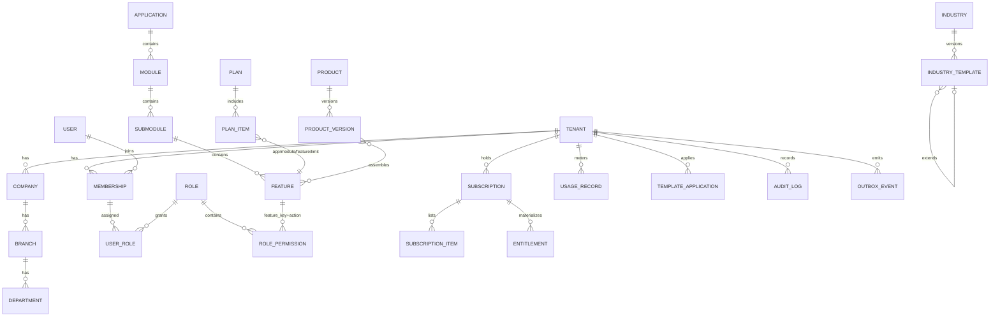

# UEOS — Master Architecture (Proposed)

Status: Proposed — awaiting approval. Decisions here are recorded individually in `docs/adr/ADR-LOG.md`.

## 1. Style and stack

**Modular monolith**, one deployable, enforced module boundaries (import-linter). Extraction to services only when measured load or team structure justifies it.

| Concern | Choice | Note |
|---|---|---|
| Backend | Python 3.12 (container) / 3.11+ (dev), FastAPI, Pydantic v2, SQLAlchemy 2.0, Alembic | Async API; typed (mypy strict on `platform/`) |
| DB | PostgreSQL 16 | Schema per module; RLS; `pgvector` for AI retrieval |
| Cache / broker | Redis (cache, Celery broker, Streams for events) | One broker; RabbitMQ only if required |
| Jobs | Celery workers, tenant-aware task context | |
| Storage | S3-compatible (MinIO in dev); keys `tenants/{tenant_id}/…` | |
| Search | Postgres FTS → OpenSearch when justified | Tenant-scoped indexes |
| Frontend | Next.js, React, TypeScript, Tailwind; metadata-driven screens; generated OpenAPI client | PWA for mobile first |
| Observability | OpenTelemetry, Prometheus, Grafana, structured logs with `tenant_id`, `request_id` | |
| CI | Lint, mypy, import-linter, pytest, Alembic up/down check, tenant-isolation suite, Playwright | |
| Dev env | Docker Compose: postgres, redis, minio, api, worker, web | |

## 2. Repository layout

```
backend/ueos/
  platform/            # shared kernel — the only thing every app may import
    identity/ tenancy/ authz/ entitlements/ subscriptions/ registry/
    audit/ events/ workflow/ notifications/ documents/ reporting/
    ai/ integrations/ config_engine/ assembly/ master/ shared/
  apps/<app>/          # finance, inventory, … (one package per domain)
    contracts/         # public: event schemas, DTOs, service interfaces
    domain/ services/ repositories/ api/ models/ manifest.yaml tests/
  industries/templates/ extensions/
frontend/web/  frontend/shared-ui/
database/migrations/ seeds/
infrastructure/docker/ deployment/ monitoring/ backup/
tests/{unit,integration,security,performance,e2e}
docs/{architecture,adr,roadmap,api,security,modules,industries}
```

Rule: `apps.X` may import `platform.*` and `apps.Y.contracts` only. Cross-app calls go through contract interfaces or events — never another app's tables.

## 3. Tenancy and isolation

- Every tenant-owned table has `tenant_id uuid not null`; composite FKs include `tenant_id` so a row cannot reference another tenant's row.
- RLS policy: `tenant_id = current_setting('app.tenant_id')::uuid`. The API connects as a non-owner role without `BYPASSRLS`. Middleware does `SET LOCAL app.tenant_id` inside each transaction. Platform-admin tooling uses a separate role and code path.
- Also tenant-scoped: cache keys, Celery task payload, object-storage prefix, search index, audit chain, rate-limit buckets.
- Deployment models: shared DB (default) · dedicated DB (tenant router, same migrations) · on-prem (same image, signed licence bundle).
- Mandatory automated suite: for every tenant-owned table, query/insert/update across tenants via API, direct session, background job, export, search and cache must fail.

## 4. Identity and authentication

Three separate principal realms, separate login surfaces and token audiences:
1. **Platform staff** (UEOS operators) — limited admin roles; no implicit tenant data access.
2. **Tenant users** (employees) — membership in one or more tenants.
3. **External users** (customers, suppliers, bidders, auditors) — portal-only, scope-limited.

Argon2id passwords · TOTP MFA (WebAuthn later) · OIDC/SAML SSO per tenant · short-lived JWT access + rotating refresh tokens bound to device session · login-anomaly events · rate limiting · password recovery with single-use tokens.

## 5. Authorization pipeline (backend-enforced, deny by default)

```
request → tenant status → subscription status → entitlement (app/module/feature/limits)
        → RBAC permission (feature_key + action) → ABAC policy (company/branch/dept/location,
          amount thresholds, hours, segregation of duties, delegation)
        → record scope (compiled into the SQL query) → field masking on output
```

- One call: `authorize(principal, feature_key, action, resource)` for commands, and `scope_filter(principal, feature_key)` returning a SQL predicate for list queries. FastAPI dependency `Requires("fin.gl.journal.post", Action.APPROVE)` is mandatory on every route; a CI test fails any route without it.
- Subscription ≠ authorization: entitlement says *the tenant may use it*; permission says *this user may*. Both must pass.
- Entitlement snapshot materialized per tenant, cached in Redis by version, invalidated by subscription events. On-prem: signed licence bundle.
- Sensitive actions (post, approve, release payroll, adjust stock, award tender) are explicit action endpoints with separation-of-duties checks — never plain PUTs.

## 6. Registries and the assembly engine

Code-first manifests (`apps/<app>/manifest.yaml`) declare application → module → submodule → feature with: slug id, `legacy_ref`, actions, dependencies, default entitlement tier, audit flag, field-sensitivity tags. A sync step upserts into `platform.registry_*` (versioned). Admin portal creates *configuration-defined* apps/modules/features/industries in the same tables (flag `origin = config|code`).

Industry templates: versioned JSON documents with `extends`. Resolution = ordered merge; provenance recorded (`source_template@version`, overridden keys). **Applying** a template copies resolved configuration into tenant-owned rows linked to the source version, so a template update never overwrites tenant data (requirement 4415). Software *products* (assembled editions) reference registry items by id — no duplication of applications.

Custom fields: registry-defined schemas, stored in `custom jsonb`, validated, GIN-indexed.

## 7. Events, workflow, integrations

- **Outbox/inbox**: events written in the same DB transaction (`platform.outbox`), relayed to Redis Streams; consumers dedupe via `platform.inbox(event_id, consumer)`. Names versioned: `inventory.stock.received.v1`; JSON Schema in each app's `contracts/`. Handlers tolerate duplicates, retries and out-of-order delivery.
- **Workflow engine v1**: JSON definition (trigger, condition, action, approval, delay, branch, loop, integration call, human task, exception handler) executed by a Postgres-persisted state machine on Celery; visual builder edits the same JSON. Approvals integrate with authz (SoD). Immutable run history.
- **Integrations**: connector registry; credentials encrypted with envelope encryption (KMS-abstracted); retries/backoff, rate limits, webhook signing, delivery logs, idempotency keys. No provider hardcoded in core.

## 8. Financial and stock integrity (cross-cutting rules)

- `NUMERIC` for money and quantity (explicit scale per currency/UoM); no floats.
- GL: deferred constraint trigger enforcing balanced transactions; posted rows immutable (trigger); corrections by reversal only; fiscal-period locks; idempotency keys on posting APIs.
- Inventory: append-only ledger; balances are projections updated in the same transaction with row locks; reconciliation job proves projection = ledger; reservations concurrency-safe.
- Other apps never write another app's authoritative tables (Finance posts GL; Inventory moves stock; WMS reports confirmed execution events).

## 9. Audit and privacy

Per-tenant hash-chained append-only `platform.audit_log` (monthly partitions; role without UPDATE/DELETE; periodic anchoring). Logs auth events, permission/subscription changes, financial postings, exports, sensitive reads (HR salary, cases), admin and break-glass actions. Field-level encryption for HR/health identifiers. Retention/deletion/export per tenant policy. Compliance wording: *supports* controls; makes no certification claims.

## 10. AI platform

Provider adapter interface (chat, embeddings, vision, speech). Model registry, prompt versioning, usage/cost metering, evaluation sets, output logging with PII controls. Agents act with the **requesting user's** authorization (on-behalf-of token). Retrieval stores ACL labels with embeddings and filters at query time. AI never writes directly to financial, stock, payroll, hiring or disciplinary records — it creates *proposals* that follow the normal approval workflow.

## 11. Extension model (ADR-007)

Tier 1 declarative (fields, forms, workflows, templates, reports) · Tier 2 external apps (OAuth, webhooks, API keys, sandbox tenants) · Tier 3 first-party in-process modules. Third-party code never runs in the core process.

## 12. Platform core ERD (Phase 1–3 scope)



Application ERDs are produced per app in its own DRD pass (Wave A first), using the schema-per-module convention and the DRD entity lists as the starting point.

## 13. API conventions

`/api/v1/{app}/{resource}`; cursor or page-based pagination, filter/sort params, RFC 7807 problem+json errors, `Idempotency-Key` on POST for financial/stock commands, ETag/If-Match on updates, OpenAPI per app, rate limits per tenant/principal, webhook signing (HMAC) with replay protection.

## 14. Testing strategy

Unit · integration (real Postgres in Docker, never SQLite) · contract tests for events · tenant-isolation suite · permission matrix tests generated from manifests · concurrency tests (oversell, double-post) · migration up/down · property tests for ledger invariants · Playwright e2e · k6 load tests against stated SLO targets · security tests (OWASP checks, authz bypass, upload) · feature-traceability report fed into `PROJECT_STATUS.md`.

## 15. Deployment

Dev: Docker Compose. Staging/prod: container images via CI/CD; Alembic migrations as a gated job; backups (PITR + per-tenant logical export); health/readiness endpoints; blue/green or rolling. Kubernetes/Helm and on-prem packaging introduced when justified (Phase 11).
